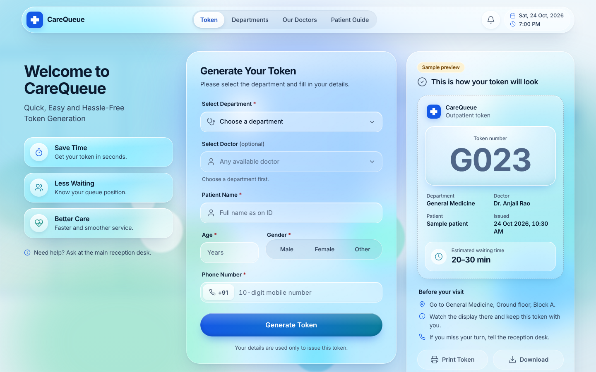

# CareQueue

**CareQueue** is a Hospital Digital Token and Queue Management System, built by **Future Coders** for the JJCET AI-PDLC Hackathon (24–25 October 2026).

> **Problem statement:** Patients wait in queues for registration and billing. Build a digital token and queue-management system that displays the current token and estimated waiting time.

| Role | Team member |
|---|---|
| Business Analyst | Sam Austin |
| Developer | Ashik Rasool |
| UI/UX Designer | Nishandhini |
| QA Tester | Rogasree |



## Run locally

CareQueue uses a Flask API and SQLite database. Run the frontend and API together from the repository root. A Render Blueprint configuration is included in `render.yaml` for a quick public demo deployment.

1. Clone the repo:
   ```bash
   git clone https://github.com/AshikAR-sys/CareQueue.git
   cd CareQueue
   ```
2. Install backend and test dependencies:
   ```bash
   python -m pip install -r backend/requirements.txt
   npm install
   npx playwright install chromium
   ```
3. Start the application:
   ```bash
   npm start
   ```
4. Open http://127.0.0.1:8000 and choose a role:
   - **Patient:** enter a name and phone number → token page
   - **Receptionist:** enter a name and the demo PIN **1234** → staff console (Call Next, Skip, Recall, Send to Billing)
   - **Waiting-room display:** the display link (no sign-in; put it on the TV)

   The browser keeps one sign-in at a time, so use **Sign out** to switch roles.

The database file is created automatically at `database/carequeue.sqlite3`. It is ignored by Git, so local queue data is not committed to the repository.

### Deploy a public demo on Render

1. Open [Render](https://render.com/) and sign in.
2. In the dashboard choose **New → Blueprint** and connect the `AshikAR-sys/CareQueue` GitHub repository.
3. Select branch `main`.
4. Let Render read `render.yaml` and create the web service. Wait for its deploy to show **Live**.
5. Open the `onrender.com` URL shown by Render and test the patient, receptionist, and display flows using sample data.

**Demo-only hosting notes:** the included Render config uses SQLite at `/tmp/carequeue.sqlite3`. Render's free web-service filesystem is ephemeral and the service can spin down when idle, so queue data can be lost on a restart/redeploy/idle spin-down and the first visit after idle may be slow. Do not enter real patient data. For data that must survive, move to a persistent managed database such as PostgreSQL before a longer-lived demo. The current PIN/login is client-side only; it is not secure access control.

### Run the tests

```bash
npm test                         # 46 unit tests (queue rules, announcements, phone tracking, reports)
npm run test:backend             # 11 Flask API + SQLite integration tests
npm run test:e2e                 # 41 browser tests against an isolated test database
npm run test:all                 # all three suites
```

## What works today

| Feature | Stories | Tested by |
|---|---|---|
| Token form with validation; tokens in order per department per day (`G001`, `G002`, `C001`) | US-01–US-03 | e2e |
| Staff console: Call Next, Skip, Recall, waiting list, missed list | US-05, US-07 | e2e |
| Send to Billing: one click finishes the patient's visit and adds them to the Billing queue (B001…), linked both ways | US-04 | unit + e2e |
| Waiting-room display: now serving + next 5 per department, live (< 2 s), token numbers only | US-06 | e2e |
| Voice announcement: press **Turn on sound** on the display; each call (and recall) plays a chime and says "Token G 0 0 1, please come to General Medicine" | US-08 | unit + e2e |
| Estimated waiting time: EWT = R + N × AST, default 3 min until 3 are served, then the average of the last 10 | US-09, US-10 | unit + e2e |
| Live estimate on the patient's token card ("About 6 min · 2 people ahead") | US-09 | e2e |
| Print token (one A5 page) and download (PNG) | US-12 | browser test |
| Track my token on my phone: the token slip has a QR code that opens a live page (no app, no login) with the token being served, people ahead, the estimated wait and an "Almost your turn" alert | US-13 | unit + e2e |
| Sign in as patient (name + phone) or receptionist (demo PIN); each page opens only for its role | US-14 | e2e |
| Queue reports (staff only): today's tokens issued, served, waiting and missed per department, average wait and service time, tokens-per-hour chart with the busiest hour, Download CSV; numbers only, live | US-15, US-16 | unit + e2e |
| Responsive Liquid Glass design; phone, tablet, desktop, TV | — | e2e (no overflow at 390 px) |

## Honest limits

- **Prototype authentication only.** The PIN check is client-side (demo PIN `1234`), not secure server-side authentication. Do not expose this prototype to the public internet or use real patient information.
- **Local server by default.** The app binds to `127.0.0.1`, so all screens on the same computer share the SQLite-backed queue. Other devices will need a deliberately configured, secured deployment.
- **Sample hospital data.** Departments, doctors and locations in `frontend/js/data.js` are sample data.
- **Queues are departments plus Billing** (G, C, O, P, D, E, and B). Patients finish at their department and are sent on
  to Billing; a separate Registration (R) queue from the PRD is not used.
- **Not built yet:** multiple counters (US-11).
- **QR tracking needs a reachable server.** A phone cannot open a laptop's `127.0.0.1`; scan the QR code on the deployed (Render) site.
- A public display endpoint returns token numbers and status only; it excludes patient names and contact details.

How this was built, stage by stage with test evidence: [`docs/automation-log.md`](docs/automation-log.md).
Role-wise backlog: [`docs/project-status.md`](docs/project-status.md).
Claude Code role conversation names and starter prompts: [`docs/role-conversations.md`](docs/role-conversations.md).
Architecture diagram and ERD: [`docs/architecture/`](docs/architecture/README.md).
Demo deck (Team 12): [`docs/deck/CareQueue_Team12_Demo_Deck.pptx`](docs/deck/CareQueue_Team12_Demo_Deck.pptx). Backup recording: [`docs/demo/CareQueue-backup-demo.webm`](docs/demo/CareQueue-backup-demo.webm).

## Project structure

```
CareQueue/
├── frontend/
│   ├── index.html, patient.html, staff.html, display.html, track.html, reports.html
│   ├── css/                 styles.css, screens.css
│   ├── js/                  UI, auth demo, queue API adapter, queue rules, vendor/qrcode.js (MIT)
│   └── assets/              hospital illustration
├── backend/
│   ├── app.py               Flask API + static frontend server
│   ├── db.py                SQLite connection and initialization
│   ├── services/
│   │   └── queue_service.py token issue and queue transitions
│   ├── tests/                API integration tests
│   └── requirements.txt
├── database/
│   ├── schema.sql            table constraints and indexes
│   └── seed.sql              sample departments and doctors
├── tests/
│   ├── queue-core.test.js, announce.test.js, track.test.js, report.test.js
│   └── e2e.test.js
├── docs/                     MRD, PRD, 6 epics, 16 stories, feature specs, architecture,
│                             demo deck, backup recording, automation log, screenshots
├── render.yaml               Render demo deployment blueprint
├── package.json
├── package-lock.json
├── .gitignore
└── README.md
```

The browser UI calls the Flask API; queue state is persisted in SQLite. The folder boundaries are functional, not placeholders.