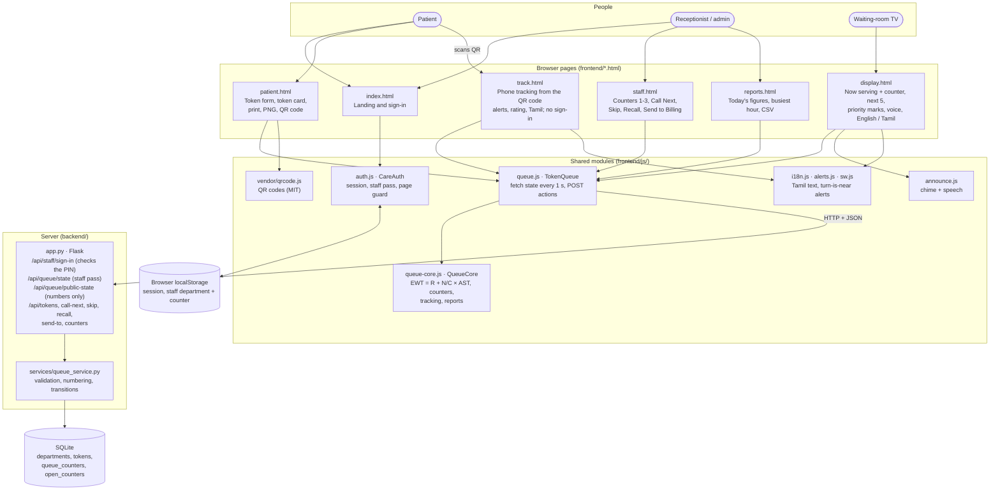
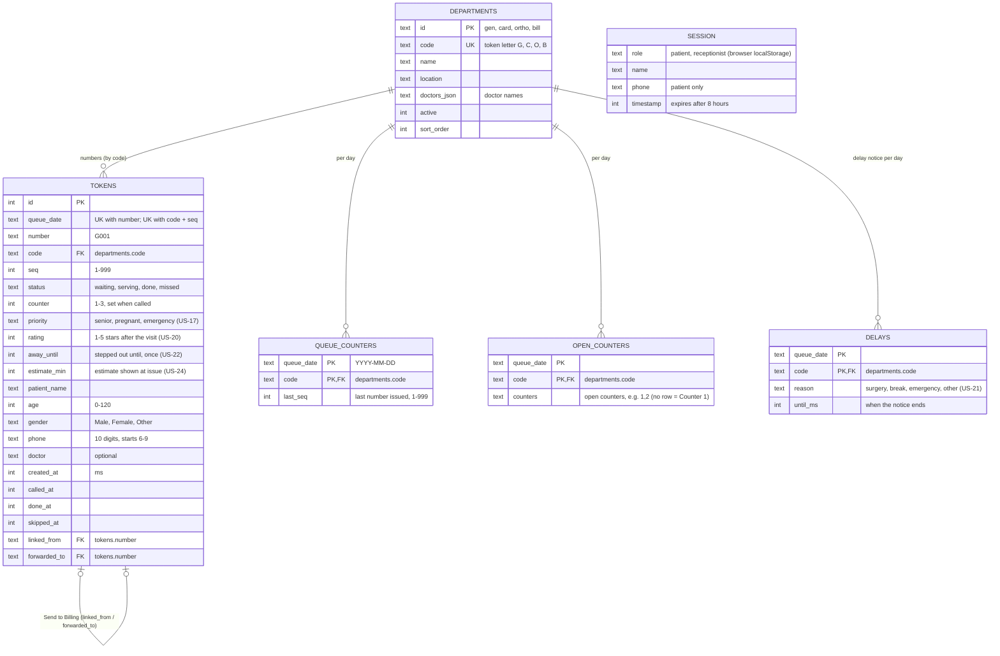

# CareQueue architecture and ERD

CareQueue (Hospital Digital Token and Queue Management System) as built on 27 Oct 2026.
Images: [`architecture.png`](architecture.png) · [`erd.png`](erd.png) · both in one PDF:
[`CareQueue_Architecture_and_ERD.pdf`](CareQueue_Architecture_and_ERD.pdf). The diagrams below are the same
content as editable Mermaid, which GitHub renders.

## System architecture

Six browser pages share a few JavaScript modules. They talk to a **Flask API**, which stores the queue in an
**SQLite** database. Every page asks the server for the queue once a second, so a change on one screen reaches the
others within about a second, on any device that can reach the server.

| Layer | What it does | Files |
|---|---|---|
| Pages | What each person sees | `index.html`, `patient.html`, `track.html`, `staff.html`, `reports.html`, `display.html` |
| Page scripts | Behaviour of one page | `app.js`, `track.js`, `staff.js`, `reports.js`, `display.js` |
| Shared modules | Rules, server calls, sign-in, voice, QR, sample data | `queue-core.js`, `queue.js`, `auth.js`, `announce.js`, `vendor/qrcode.js`, `data.js`, `screens.js` |
| API | Validates and applies every queue change | `backend/app.py`, `backend/services/queue_service.py` |
| Database | Today's tokens, numbering, open counters | `database/schema.sql`, `database/seed.sql`, `backend/db.py` |
| Hosting | Public demo | `render.yaml` (Render free web service, gunicorn; deploys on every push to `main`) |
| Tests | 93 unit, 37 API, 67 browser tests; GitHub Actions on every pull request | `tests/`, `backend/tests/`, `.github/workflows/test.yml` |

**Privacy:** only the staff console loads `/api/queue/state`, which includes patient names and phones. The token
page, phone tracking page, display and reports load `/api/queue/public-state`, which has token numbers, times,
statuses and counters only. Browser tests check that no name reaches those pages.

**Staff sign-in:** `POST /api/staff/sign-in` checks the PIN on the server and returns a signed staff pass (8 hours).
The full queue and every queue action need that pass; patient and public routes do not.

**Known limits:** one shared staff PIN, no personal accounts and no limit on sign-in attempts. Pages poll every second instead of receiving server push. On the free Render plan the SQLite
file lives in `/tmp` and is reset on every redeploy or restart. Departments are listed in both `seed.sql` (server)
and `data.js` (pages), so the two must be kept in step.

## Entity relationship diagram

The SQLite tables from `database/schema.sql`. Patient details are stored on each token row. Doctors are a JSON list
on the department. The sign-in session is kept in the browser, not in the database.

How the tables are used:
- **Token numbers:** `queue_counters` keeps the last number per queue per day, so numbers restart each day.
- **Unique numbers:** two unique keys stop a number repeating on the same day.
- **Counters (US-11):** `open_counters` lists the service counters open per queue per day. `tokens.counter` records
  which counter called each token.
- **Older database files:** `upgrade_schema()` adds the columns that newer versions introduced.
