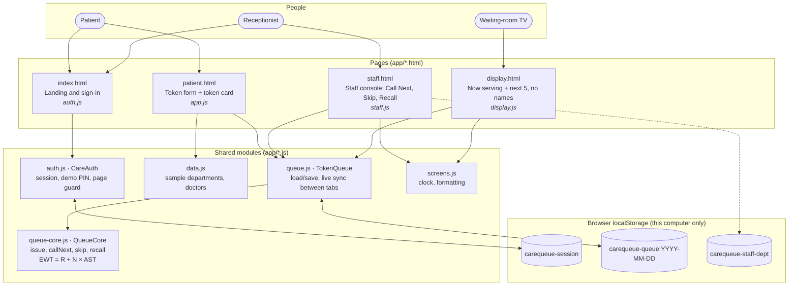
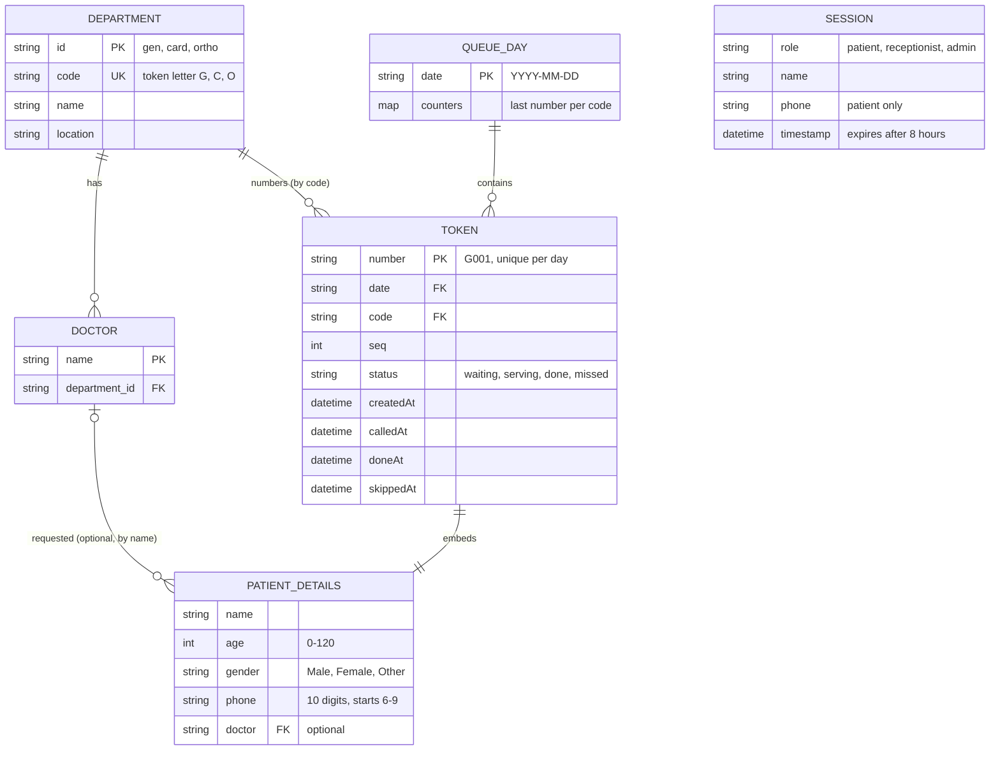

# CareQueue architecture and ERD

CareQueue (Hospital Digital Token and Queue Management System) as built on 25 Oct 2026.
Images: [`architecture.png`](architecture.png) · [`erd.png`](erd.png) · both in one PDF:
[`CareQueue_Architecture_and_ERD.pdf`](CareQueue_Architecture_and_ERD.pdf). The diagrams below are the same
content as editable Mermaid, which GitHub renders.

## System architecture

A static web app: four HTML pages share five JavaScript modules and keep their data in the browser's
`localStorage`. **There is no server and no database**, so the queue is shared only between tabs of one browser on
one computer.

| Layer | What it does | Files |
|---|---|---|
| Pages | What each person sees | `index.html`, `patient.html`, `staff.html`, `display.html` |
| Page scripts | Behaviour of one page | `app.js`, `staff.js`, `display.js` |
| Shared modules | Rules, storage, sign-in, sample data | `queue-core.js`, `queue.js`, `auth.js`, `data.js`, `screens.js` |
| Storage | Today's queue, who is signed in | `localStorage` keys `carequeue-*` |
| Tests | 19 unit tests on the rules; 18 browser tests on all pages together | `tests/queue-core.test.js`, `tests/e2e.test.js` |

**Live sync:** when one tab changes the queue, the browser's `storage` event tells the other tabs at once; a
1-second check is the fallback. **To scale beyond one computer:** keep `TokenQueue`'s functions, replace its
`load`/`save` with API calls and server push, and run `queue-core.js` on the server unchanged.

## Entity relationship diagram

A **logical** model of the data CareQueue stores today. Keys are logical (there are no database constraints):
departments and doctors come from `app/data.js`; queue days, tokens and sessions are JSON in `localStorage`;
patient details are stored inside each token.

`SESSION` has no relationship to the other entities: it records who is signed in on this browser (one sign-in at a
time). Patient details are never sent to the waiting-room display (`QueueCore.publicView` returns token numbers and
estimates only; covered by a unit test and a browser test).
